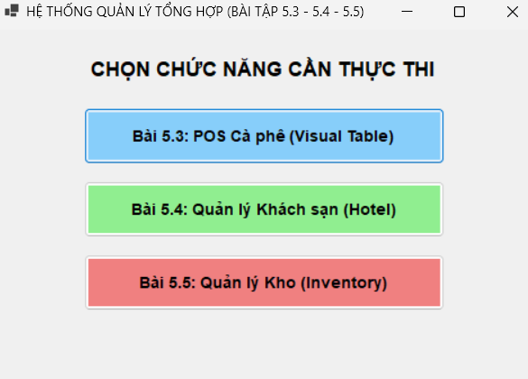
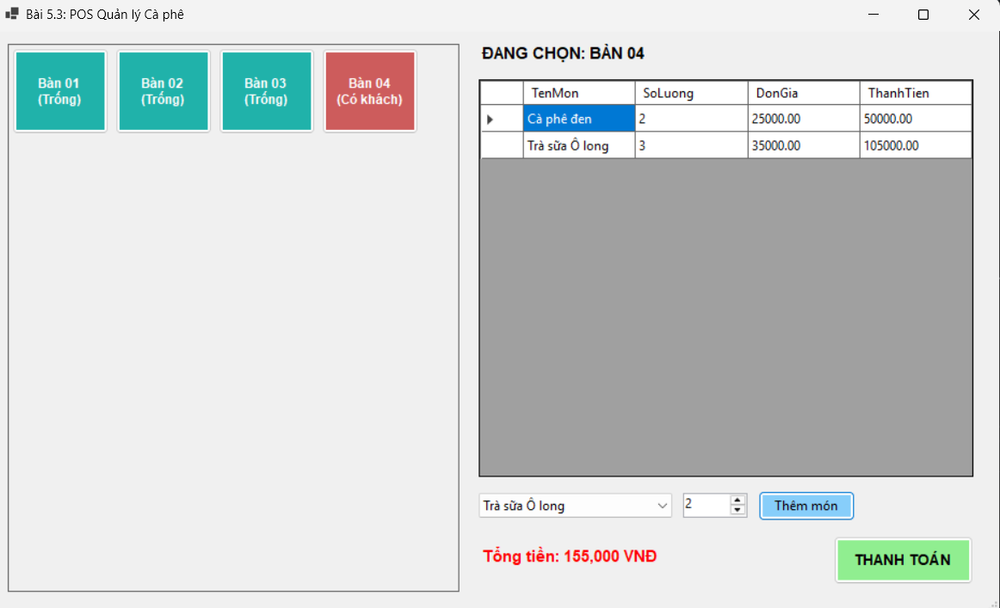
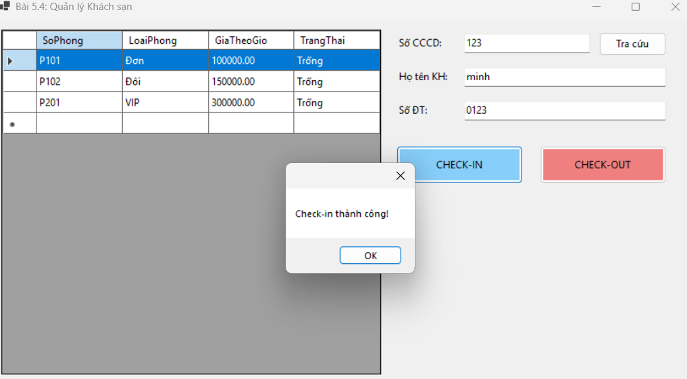
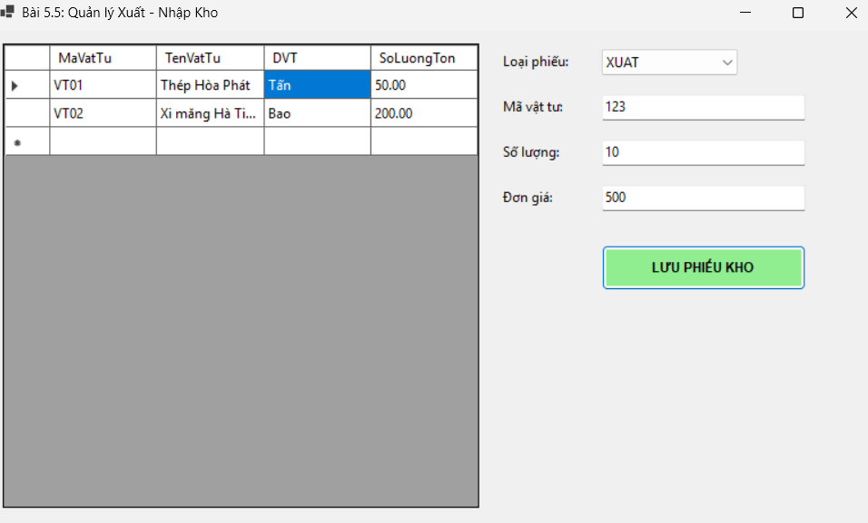
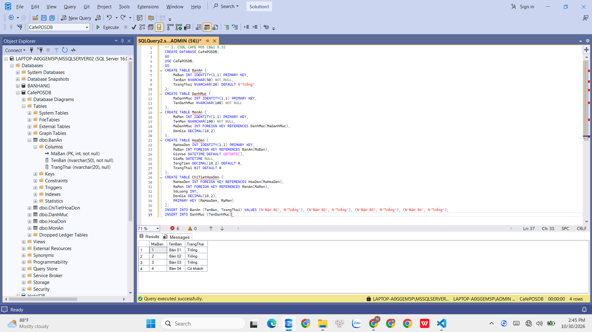

# BÁO CÁO BÀI TẬP LỚN - HỆ THỐNG QUẢN LÝ TỔNG HỢP (3-TIER ARCHITECTURE)

---

## MỤC 1: THÔNG TIN SINH VIÊN

- **Họ và tên sinh viên:** Nguyễn Tiến Nhật Minh
- **Mã sinh viên:** 24810320038
- **Tên Đề tài / Bài tập:** Tích hợp 3 ứng dụng WinForms: Bài 5.3 (POS Cà phê), Bài 5.4 (Quản lý Khách sạn) và Bài 5.5 (Quản lý Xuất - Nhập Kho) trong cùng một Solution kiến trúc 3 lớp (3-Tier Architecture).

---

## CẤU TRÚC THƯ MỤC DỰ ÁN (3-TIER ARCHITECTURE)

```text
baitapngay3010/
├── Database/
│   └── ScriptDB.sql             # Script SQL khởi tạo 3 CSDL và dữ liệu mẫu
├── images/                      # Thư mục lưu trữ hình ảnh báo cáo
│   ├── 01_main_screen.png
│   ├── 02_53_screen.png
│   ├── 03_54_screen.png
│   ├── 04_55_screen.png
│   └── 05_sql_screen.png
├── src/                         # Thư mục mã nguồn C#
│   ├── DTO/                     # Data Transfer Objects (AppDTO.cs)
│   │   └── AppDTO.cs
│   ├── DAL/                     # Data Access Layer (DatabaseHelper.cs, AppDAL.cs)
│   │   ├── DatabaseHelper.cs
│   │   └── AppDAL.cs
│   ├── BUS/                     # Business Logic Layer (AppBUS.cs)
│   │   └── AppBUS.cs
│   ├── Forms/                   # Presentation Layer - GUI Forms
│   │   ├── FormMain.cs
│   │   ├── FormCafe.cs
│   │   ├── FormHotel.cs
│   │   └── FormInventory.cs
│   ├── Program.cs               # Khởi chạy ứng dụng
│   └── hoccsharp.csproj         # File cấu hình dự án C#
├── README.md                    # File báo cáo chi tiết dự án
└── hoccsharp.sln                # File Solution của Visual Studio
```

---

## MỤC 2: HƯỚNG DẪN CÀI ĐẶT & CHẠY DỰ ÁN

1. **Khởi tạo CSDL SQL Server:**
   - Mở **SQL Server Management Studio (SSMS)**.
   - Bấm `Ctrl + O` chọn mở file `Database/ScriptDB.sql`.
   - Nhấn `F5` (Execute) để thực thi toàn bộ Script khởi tạo 3 CSDL (`CafePOSDB`, `HotelDB`, `InventoryDB`) cùng các bảng dữ liệu mẫu.

2. **Mở dự án:**
   - Mở file `hoccsharp.sln` bằng Visual Studio 2022 hoặc mở thư mục dự án bằng VS Code.

3. **Cấu hình chuỗi kết nối:**
   - Mở file `src/DAL/DatabaseHelper.cs`.
   - Cập nhật biến `ServerName` khớp với tên Instance SQL Server trên máy cá nhân (Ví dụ: `.\SQLEXPRESS` hoặc `.\MSSQLSERVER02`).

4. **Cài đặt thư viện & Chạy chương trình:**
   - Mở Terminal tại thư mục `src/` và chạy các lệnh:
     ```bash
     dotnet add package System.Data.SqlClient
     dotnet run
     ```
   - Hoặc nhấn `F5` trong Visual Studio 2022 để Build & Run ứng dụng.

---

## MỤC 3: HÌNH ẢNH KẾT QUẢ CÁC MÀN HÌNH CHỨC NĂNG

1. **Màn hình Chính / Điều hướng trung tâm:**  
   

2. **Màn hình Bài 5.3 - Quản lý POS Cà phê:**  
   

3. **Màn hình Bài 5.4 - Quản lý Khách sạn:**  
   

4. **Màn hình Bài 5.5 - Quản lý Xuất / Nhập Kho:**  
   

5. **Minh họa Khởi tạo CSDL trên SSMS & Xử lý giao dịch:**  
   

---

## MỤC 2: HƯỚNG DẪN CÀI ĐẶT & CHẠY DỰ ÁN

1. **Khởi tạo CSDL SQL Server:**
   - Mở **SQL Server Management Studio (SSMS)**.
   - Bấm `Ctrl + O` chọn mở file `Database/ScriptDB.sql`.
   - Nhấn `F5` (Execute) để thực thi toàn bộ Script khởi tạo 3 CSDL (`CafePOSDB`, `HotelDB`, `InventoryDB`) cùng các bảng dữ liệu mẫu.

2. **Mở dự án:**
   - Mở file `hoccsharp.sln` bằng Visual Studio 2022 hoặc mở thư mục dự án bằng VS Code.

3. **Cấu hình chuỗi kết nối:**
   - Mở file `src/DAL/DatabaseHelper.cs`.
   - Cập nhật biến `ServerName` khớp với tên Instance SQL Server trên máy cá nhân (Ví dụ: `.\SQLEXPRESS` hoặc `.\MSSQLSERVER02`).

4. **Cài đặt thư viện & Chạy chương trình:**
   - Mở Terminal tại thư mục `src/` và chạy các lệnh:
     ```bash
     dotnet add package System.Data.SqlClient
     dotnet run
     ```
   - Hoặc nhấn `F5` trong Visual Studio 2022 để Build & Run ứng dụng.

---

## MỤC 3: HÌNH ẢNH KẾT QUẢ CÁC MÀN HÌNH CHỨC NĂNG

1.  

2.  

3.  

4.  

5.  
